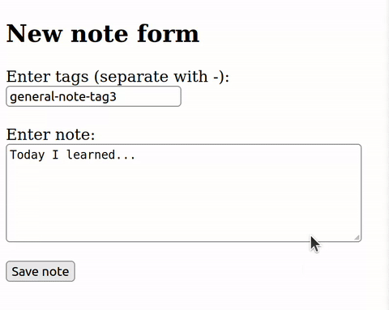
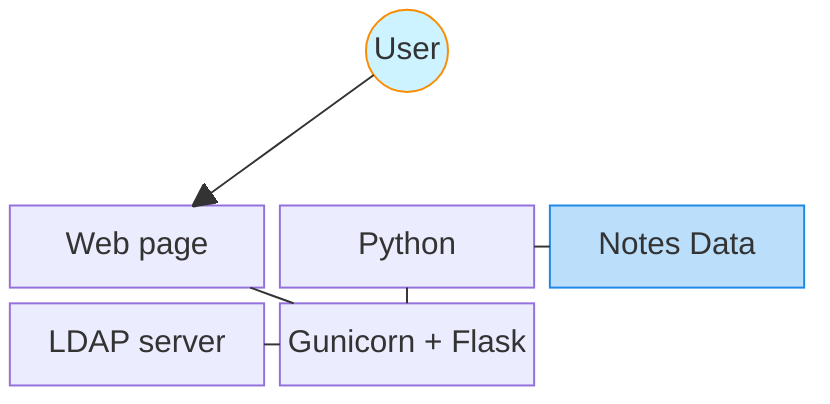

# Noted Flask App Design



## Pain Point

Different mobiles and computer devices do not contain the same built-in applications for creating new notes or retrieving previous notes, making it especially cumbersome to create and retrieve notes across different networks without utilising third-party services.

## Story and Vision

In last quarter of 2024 while working towards certifications, I became interested in faster note-taking. I started thinking about a quicker way to write my notes to the same place from different devices.

I researched in-built CLI commands such as dialog and zenity, then progressed my initial idea idea to a working command:
```bash
alias noted='zenity --forms --add-entry="Tags" --add-entry="Note" | awk -F "|" '\''{print "#"$1"\n\n\n"$2}'\'' > ~/noted/"$(date '\''+%Y-%m-%d_%H-%M-%S'\'' )"'
```

While using the command and continuing along my certifications work, the content I was doing included tutorial examples on containerised Nginx and Python applications.

Most of the web applications I had been deploying that year were using Nginx or Apache but when I researched the setup, adding user forms and data storage was actually supported with addons and extensions. This prompted me to switch lanes in my research and find Flask, a popular Python web backend.

## Setting Aim

The initial project aims were formed in 2025:
- Design a simple, persistent notes-taking application
- To be able to use the application from any device

## Development

Developed the application during 2026 to meet the project aims:

- Selected Python to form simple codebase
- Developed use for browser since all user devices have one installed
- Containerised to provide persistent app storage and increase runtime consistency

Flask had simplest setup to provide Python with web functions.

## The Tech Stack



* Gunicorn serves the application within an SSL wrapper
* Flask renders HTML pages and request data from endpoints
* An LDAP server validates users for Flask
* Python processes the request data to build notes files


## The Inner Core

Python functions in [`app.py`](https://github.com/debuglachy/noted-flask-app/tree/main/web/app.py) call standard modules and modules from imported libraries including flask. The modules define URLs and control access, process and transform the data, and handle files and folders.

---

## The Challenges

### Making it about the notes

I posted my first note once the form started working and when pressing 'Back' on the web page, the form would load filled in with the saved note and required manual clearing. Additionally, the form was blank on the first launch of the app and user would be required to recall or refer to the text around the boxes to start. Added a dedicated save button and some guiding text replacing the empty boxes to keep all user focus on the note to be written rather than navigating / checking which boxes to use.

### Unexpected inputs

After outputting the first files by transposing the user input directly into the filenames, I saw some filenames that were much longer than other files on the computer. I realised there could be unexpected results for filenames exceeding the host's filesystem limits, so added extra application code that would trim input where required. This meant that some of the input could potentially be trimmed away so used the tag line to persist the data. The tags line was standard across files and I scripted a sorting function to sort the notes into folders labelled by knowledge category.

### A build architecture assumption

I ran into beginner troubles when first publishing the image successfully to docker as I had used docker CLI commands from a device running on an arm32 image. When I ran the built image on an amd64 device, I noticed either the app wasn't building or built but the container stayed in 'pending' status. I soon realised I needed to upgrade the device to arm64. Once on arm64, then I learnt about adjusting build architecture options to ensure amd64 images were built by the docker CLI command.

### The latest from the pipeline

My CI pipelines for the application would package images with commit tags and then 'latest' tags automatically. When I compared running these versus the images I had built from CLI commands, I found out the 'latest' image was building without flask or other dependencies. Although the files from one job's workspace were not available in the next job's workspace, there was an environment variable being passed that pip uses to keep a record of installed packages.

The container without dependencies would enter into a crash loop and to determine the cause, custom shell commands were added to different stages that checked contents and variables. As the packages were missing, an option to pip was added that forces package installations and effectively causes pip to ignore the installation record.

---

## Container security learnings

In last quarter of 2026, I focused development on addressing the major security limitations: no user authentication method included and connections unencrypted.

### Adding authentication

A suitable sidecar container was selected so users could be authenticated. The application and sidecar container both configure from environment variables such as LDAP settings and passwords. Docker's [best practices](https://docs.docker.com/build/building/best-practices/#env) document described setting the values through secrets mounts in place of the environment variables.

For the application, additional commands were added to the Dockerfile to export variables from the secret mount, start the flask application and unset the values again within the same command string. As the variables are set when the application launches, the values get mapped into the configuration.

For the sidecar container, solutions were trialed including using the dedicated pre-startup command and activating the custom script directories to source from the secret mount. During the tests, I confirmed that settings were sourced only after the environment bootstrapping. This caused the unmodified values to flow into the initial LDAP setup. A Dockerfile was added to set the entrypoint command, and this ensured the required files were getting modified prior to the environment scripts executing. Additional code may still be necessary to sanitise the modified files and keep values out of the image contents.

### Adding encrypted connections

Gunicorn was chosen from the official Flask recommended production setups. As Gunicorn required a python package to serve from; while the Gunicorn file setup was minimal, the application Dockerfile required significant reworking.

---

## The Deployment

Leaving the variable out will expose HTTPS over port 8080.
```bash
docker compose up
```

---

Written by Lachlan Christie.

See [noted-flask-app](https://github.com/debuglachy/noted-flask-app/).

Refer back to the [LICENSE](../../LICENSE).

