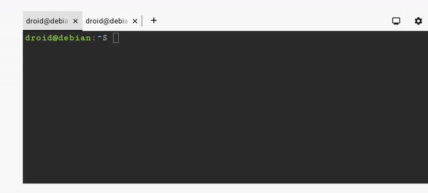

# Simple Lab Infrastructure Management Setup

## Problem Statement and Project Aim

Following the [Android 16 release](https://source.android.com/docs/whatsnew/android-16-release#virtualization) adding Linux terminal support in 2025, planned to setup infrastructure management entirely from the application now in-built to mobile phones.

## Mobile Setup

- Mobile phone Developer Mode temporarily enabled with the [official steps](https://developer.android.com/studio/debug/dev-options#enable)
- Terminal app enabled with *Developer options* > *Linux development environment* slider
- Terminal app launched from mobile's applications icons
- Developer Mode disabled again

> [!TIP]
> Mobile can be connected to docking station at any time to provide keyboard, mouse, external monitor and LAN connections. *Desktop mode* automatically launches when using a monitor.

## Infrastructure Setup

| Mobile Phone Location | Connection to Lab's Infrastructure Network |
| --- | --- |
| Lab | LAN or WIFI |
| Off-Site | VPN + mobile cellular data |

- Static IP and SSH daemon enabled on each device to be managed
- Executed `ssh-copy-id` in the Terminal app to each target server
- SSH hardened on target servers (non-extensive list: password authentication and root login)

## The Complete Stack

With the in-built Terminal app, infrastructure management is performed from a single mobile device.

## Challenges

### Crash Testing

With the initial versions of the Terminal app, experienced both unrecoverable and recoverable crashes while testing features that were under development such as running graphical applications. Crashes were also caused by bootstrapping or installing additional VMs within the Debian VM or experimenting with different settings in Terminal app for the VM's disk size and memory allocations.

### Navigating VM Isolation

Connection was working to the static IP addresses but not to hostnames as the Debian VM's virtual network interface is isolated from these by default. Due to the low number being managed in the current setup, this resolved simply by making additions to `/etc/hosts` file on the VM.

## The Completed Deployment

Focusing on achieving the project aims, no additional packages were required on the Terminal app Debian VM.  

Reset Terminal app and connected servers. No crashes occurred.  

---

Written by Lachlan Christie.

